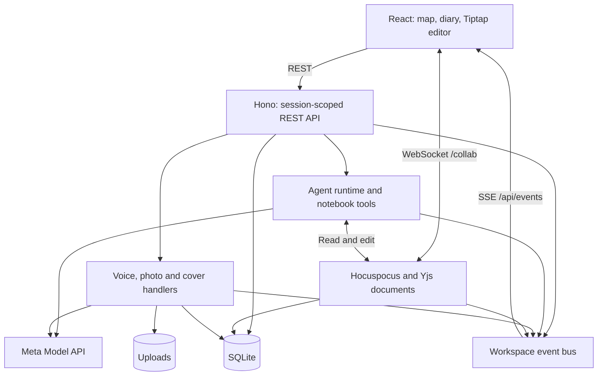

# Inkwell

Inkwell is a notebook that writes back, inspired by Tom Riddle's diary: Notion-style pages with ChatGPT-style agents that act on your notebook. Its living map takes its cue from the Marauder's Map, turning pages into places and agents into named footprints as they read and edit.

**[Open Inkwell](https://inkwell.76-13-246-244.sslip.io)** · [Source](https://github.com/GLDRoger/inkwell) · [Demo script](docs/DEMO.md) · [Submission draft](docs/SUBMISSION.md)

## What you can do

- Write in the diary. Your ink sinks into the page, and the agent's reply appears as streamed handwriting.
- Ask Scout to research, Wren to write, or Atlas to organise. Agents can read, search, create, edit, rename, move and soft-delete pages, or ask another agent for help.
- Watch their footprints and tool steps. Open a page to see edits arrive in the same live document you can edit yourself.
- Pan and zoom from the notebook's layout to page excerpts. Open a card for the full editor.
- Speak into the diary microphone. Review the transcript before sending it.

A new anonymous visitor gets a seeded notebook. The notebook, editor and map work without an API key; AI requests need a server-side `META_API_KEY`. Do not put sensitive material in the public demo. Requested page content, images and audio are sent to Meta when those features run.

The diary has a photo-to-cards control, and the page toolbar has “Paint a cover”. Both call server-side media handlers and update the notebook. These controls, live model quality and a complete recorded demo still need browser verification; see the [submission TODOs](docs/SUBMISSION.md#before-submitting).

## Meta models in the code

These are the configured defaults, not a claim of measured model performance.

| Model | What Inkwell sends and does | Implementation |
| --- | --- | --- |
| Muse Spark (`muse-spark-1.3`) | Runs tool-calling agents and streams diary replies. The adapter sets `tool_choice: auto`, translates the token-limit field and removes unsupported request fields. | [`model.ts`](src/server/agents/model.ts), [`runtime.ts`](src/server/agents/runtime.ts), [`tools.ts`](src/server/agents/tools.ts) |
| Muse Voice Transcribe (`muse-voice-transcribe-1.0`) | Transcribes recorded speech. The browser converts audio to WAV; the server validates mono, 16-bit PCM at 16 or 24 kHz and calls `/asr/transcribe`. | [`recorder.ts`](src/client/diary/recorder.ts), [`Composer.tsx`](src/client/diary/Composer.tsx), [`transcribe.ts`](src/server/media/transcribe.ts) |
| SAM 3.1 (`sam-3.1`) + Muse Spark vision | Sends a photo to SAM for note bounding boxes, then sends the original image and boxes to Spark for text and positions. Creates a parent page and one card per returned note in a transaction. Uses boxes, not cropped masks; falls back to vision when SAM fails or returns no boxes. | [`photo.ts`](src/server/media/photo.ts), [`boxes.ts`](src/server/media/boxes.ts) |
| Muse Image (`muse-image-1.0`) | Generates a parchment-style PNG from a page title and excerpt, stores it as an attachment and sets the page's cover. | [`illustrate.ts`](src/server/media/illustrate.ts), [`map-card.tsx`](src/client/map/map-card.tsx) |

Model IDs and the API base URL can be changed in [`.env.example`](.env.example). There is no implemented local-model mode.

## Architecture

One TypeScript application. React and Vite serve the client; Hono runs on Node 22. SQLite stores notebook records and Yjs state. Hocuspocus synchronises open editors; server-sent events carry diary text, page updates and agent movement. The shared contract is [`src/shared/types.ts`](src/shared/types.ts).



Tools run within the requesting workspace. Agent writes use live Yjs documents, with per-page locks for competing agent operations. Child runs retain a parent ID and share tool and handoff budgets. Cancellation stops a run and its active descendants; it does not undo edits already made.

## Run locally

Use Node.js 22 or newer and npm.

```sh
npm ci
cp .env.example .env
# Set META_API_KEY privately in .env. Never commit it.
npm run dev
```

Open `http://localhost:5173`. The API listens on `8787`; Vite proxies `/api` and `/collab`. Data defaults to `./data`; set `DATA_DIR` to use a separate notebook store.

For a production build:

```sh
npm run build
NODE_ENV=production npm start
# http://localhost:8787
```

## Checks and agent corpus

```sh
npm run typecheck
npm test
node --test scripts/corpus/fake-server.test.mjs
```

Tests cover agent tools and live document changes with mocked models, media request/response handling, and client state and map logic. They do not establish live model quality or replace a browser rehearsal.

The corpus exercises twelve notebook tasks through HTTP and SSE, including long-page edits, handoffs and stream integrity:

```sh
# With the local server running and a Meta key configured:
npm run corpus -- --base http://localhost:8787 --json /tmp/inkwell-corpus.json
npm run corpus -- --case handoff_to_wren --repeat 3
```

Corpus runs spend model credits and create disposable workspaces that remain in the target store. Use a dedicated local `DATA_DIR`. The report checks persisted outcomes and records friction; it is not a prose-quality judge. See [the corpus guide](scripts/corpus/README.md).

## Deploy

The supplied deployment uses one Docker container behind nginx, with SQLite and uploads under `/opt/inkwell/data`. It targets the existing Hostinger setup and keeps Inkwell separate from the neighbouring Spaces deployment.

```sh
# Requires the configured SSH host and first-time nginx/TLS setup.
# Deploys committed HEAD, not uncommitted changes.
./deploy/deploy.sh hostinger-hermes
```

Follow [the deployment guide](deploy/README.md) for credentials, TLS, health checks and environment updates. There is no automated schema/data rollback. Do not deploy another project's configuration or replace its data.

## Hackathon materials

Built for the Meta Global AI Developer Hackathon theme, “Build for Your World.” [The demo script](docs/DEMO.md) plans a 2:30 recording; [the submission draft](docs/SUBMISSION.md) separates implemented paths from evidence still needed. [The plan](docs/PLAN.md) records the original direction, including ideas not yet implemented.
