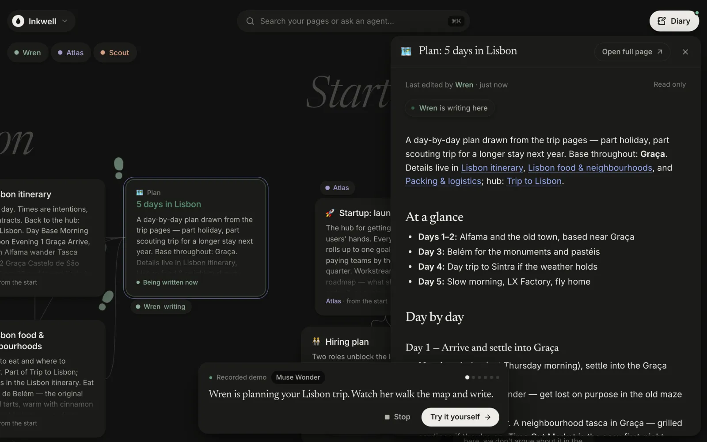
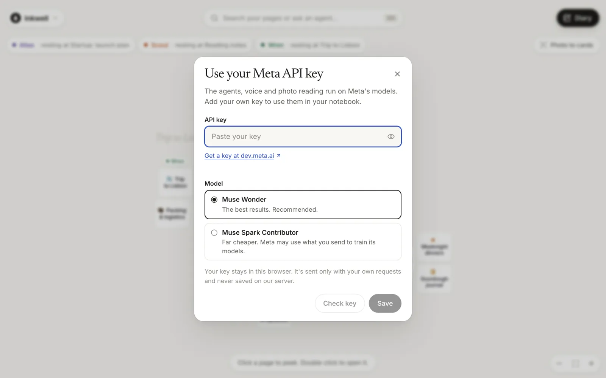
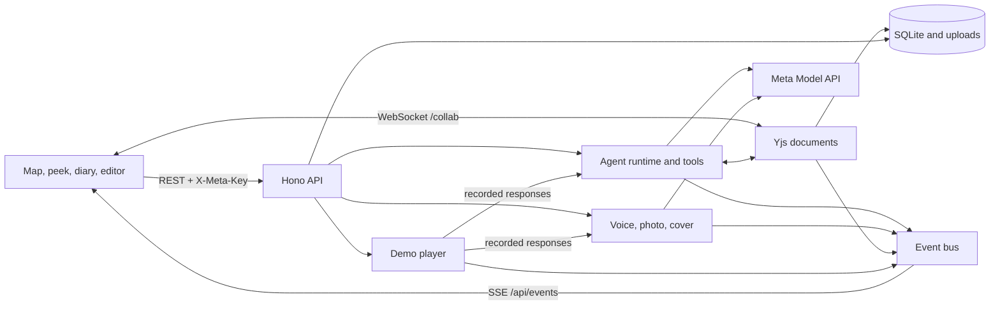

# Inkwell

A notebook that writes back.

You write a request in the diary, and an agent does the work in your pages: it reads, drafts, edits, links and files. While it works you can see where it is. Every page is a card on a map of the notebook, the agent's footprints move between the cards it reads and changes, and its words arrive in the open page as wet ink that dries. Three agents run on Meta's Muse Wonder: Scout researches, Wren writes, Atlas organises, and they can hand work to each other.

**Live: [inkwell.76-13-246-244.sslip.io](https://inkwell.76-13-246-244.sslip.io)**

- **Watch it work** needs nothing. It plays a two-minute recording of real Muse Wonder, Muse Voice, SAM 3.1 and Muse Image runs, replayed through the live agent runtime in a throwaway demo notebook.
- **Try it yourself** gives you your own notebook and a four-step guide. The AI features need a Meta API key ([dev.meta.ai](https://dev.meta.ai)); the key stays in your browser.

[Submission](docs/SUBMISSION.md) · [Video script](docs/DEMO.md) · [Demo design](docs/DEMO-MODE.md) · [Visual design](docs/DESIGN.md) · [Build log](docs/PLAN.md)




## The two ways in

**Watch it work.** The app plays itself in a separate demo notebook, reset on every start. Six steps, each captioned and labelled with the model that did the work:

1. Wren plans five days in Lisbon: reads the trip pages, creates "Plan: 5 days in Lisbon" and links it from the itinerary (Muse Wonder).
2. A spoken request, transcribed by Muse Voice, asks Scout to summarise the reading notes on a new page.
3. Scout finds the hiring decision and hands off to Wren, who drafts the job post (Muse Wonder, handoff).
4. Photo to cards on a photo of sticky notes: SAM 3.1 finds each note and Muse Wonder reads it (SAM 3.1 + Muse Wonder).
5. Muse Image paints a cover for the Lisbon plan.
6. Atlas links the new pages into the right parts of the notebook (Muse Wonder).

The camera follows the agent across the map, and the page being written opens in the peek panel so you see each edit land. Replies are marked "Recorded run · Muse Wonder". Stop, or **Try it yourself**, at any time.

**Try it yourself.** Your own notebook, seeded with a Lisbon trip, a startup launch plan, reading notes and recipes. A short guide covers the map, the diary, photos and voice, and the key. The key dialog offers two text models: **Muse Wonder** (`muse-wonder-1.0`, default) or **Muse Spark Contributor** (`muse-spark-1.3-contributor`, far cheaper; Meta may train on what you send). Wonder has no Contributor tier.



## What you can do

- **Ask in the diary.** Pick Scout, Wren or Atlas, or leave it on **Any agent** and Inkwell routes by the request's verb (an attached image goes to Wren). Agents use eleven tools: `list_pages`, `search_pages`, `read_page`, `create_page`, `append_to_page`, `edit_page`, `rewrite_page`, `rename_page`, `move_page`, `delete_page`, `ask_agent`. A failed reply offers **Try again**; one that ran out of time or steps offers **Continue**.
- **Watch the map.** Agents walk between cards as they read, write and think. A greeting says what they did since you were last there.
- **Peek and edit.** A single click on a card opens the page beside the map (a bottom sheet on phones); a double-click opens it full size. Pages are live Tiptap documents, and agent edits stream in with the agent's name on its caret while you type.
- **Speak.** The microphone records, Muse Voice transcribes, and the text lands in the composer for you to check before sending.
- **Photo to cards.** A photo of sticky notes or a whiteboard becomes one page per note, placed on the map roughly where the note sat.
- **Make a cover.** Muse Image paints a cover from the page's title and opening text.
- **Delete with undo.** Deleting a page waits a few seconds behind an Undo notice.

There is no sign-in. Each browser gets an anonymous notebook, deleted 90 days after its last visit. Don't put anything sensitive in the public app: with your key, text, images and audio go to Meta's API.


## How Inkwell uses Meta's models

Every model call goes to the Meta Model API (`https://api.meta.ai/v1`, OpenAI-compatible). Every path below was checked live on 2026-10-30, with `scripts/smoke-meta.mjs` (5/5 on Wonder and on Spark) and by recording the demo from the real API.

| Model | What it does | Code |
| --- | --- | --- |
| **Muse Wonder** (`muse-wonder-1.0`) | Runs the three agents: streamed replies and tool calls through `/chat/completions` (the API accepts only `tool_choice: "auto"` and `max_completion_tokens`). Reads images attached to a diary request. In Photo to cards, reads each note's text using SAM's boxes. | [`agents/model.ts`](src/server/agents/model.ts), [`agents/runtime.ts`](src/server/agents/runtime.ts), [`agents/tools.ts`](src/server/agents/tools.ts), [`media/photo.ts`](src/server/media/photo.ts) |
| **Muse Spark Contributor** (`muse-spark-1.3-contributor`) | The visitor's cheaper alternative to Wonder for the same jobs, allow-listed server-side. | [`meta-access.ts`](src/server/meta-access.ts), [`key/KeyDialog.tsx`](src/client/key/KeyDialog.tsx) |
| **Muse Voice Transcribe** (`muse-voice-transcribe-1.0`) | Turns a diary recording into text. The browser records 16 kHz WAV; the server checks the format and posts multipart to `/asr/transcribe`. | [`diary/recorder.ts`](src/client/diary/recorder.ts), [`media/transcribe.ts`](src/server/media/transcribe.ts) |
| **SAM 3.1** (`sam-3.1`) | Finds each sticky note or block of handwriting in a photo, through `/responses`. Its boxes go to Muse Wonder with the image and set where each card lands. The notice says "Read by SAM 3.1 + Muse Wonder" only when SAM found the notes; otherwise "Read by Muse Wonder". | [`media/photo.ts`](src/server/media/photo.ts), [`media/boxes.ts`](src/server/media/boxes.ts) (tested on [a real SAM response](src/server/media/fixtures/sam-3.1-sticky-notes.txt)) |
| **Muse Image** (`muse-image-1.0`) | Page covers from `/images/generations`. Also painted all 14 objects on the welcome screen. Muse Image has no transparent output, so [`paint-objects.mjs`](scripts/paint-objects.mjs) paints each object on a plain grey backdrop and cuts it out locally (Apple Vision subject mask, then a colour matte that unmixes the grey from the edges). | [`media/illustrate.ts`](src/server/media/illustrate.ts), [`scripts/paint-objects.mjs`](scripts/paint-objects.mjs), [`welcome/objects.ts`](src/client/welcome/objects.ts) |

The interface names the model at the moment it works: "Written with Muse Wonder" under a reply, "Transcribed by Muse Voice" in the composer, "Read by SAM 3.1 + Muse Wonder" after a photo import, "Making a cover with Muse Image…" on the page, and a model chip on every demo step.

## Architecture

One TypeScript app in one container. The shared contract is [`src/shared/types.ts`](src/shared/types.ts).

- **Client:** React 19 and Vite: the map ([`src/client/map`](src/client/map)), the peek panel ([`src/client/peek`](src/client/peek)), the diary ([`src/client/diary`](src/client/diary)), pages with a Tiptap 3 editor ([`src/client/page`](src/client/page)), the guide and key dialog.
- **Server:** Hono on Node 22, SQLite (better-sqlite3), Hocuspocus for live Yjs documents at `/collab`, and server-sent events at `/api/events` for diary ink, page changes, footprints and demo steps.
- **Agents:** the Vercel AI SDK against the Meta Model API. Agents write through the same Yjs documents the editor is connected to, so their changes reach anyone with the page open; there is no second copy to merge.



### What holds it together

- **Version-checked edits.** `read_page` returns a version of the page's text. `edit_page` and `rewrite_page` must pass it back and are refused if the page changed since, so an agent never writes over what a person just typed; it is told to read again. `edit_page` needs one exact, unique match. ([`tools.ts`](src/server/agents/tools.ts), [`page-edit.ts`](src/server/agents/page-edit.ts))
- **Per-page locks.** Writes to one page queue behind each other across all runs. ([`runtime.ts`](src/server/agents/runtime.ts))
- **Handoffs with budgets.** `ask_agent` starts a child run and waits for it. Parent and children share one tool-call budget; a child gets a share of its parent's tokens and time. Handoffs stop three levels deep, and stopping a run stops its children.
- **Restart recovery.** A run still marked running at boot is closed as "Interrupted by a server restart." and the diary offers Try again. A retry continues an interrupted reply instead of redoing it.
- **First-byte watchdog.** Muse Wonder sometimes sends nothing for 30 to 90 seconds before a step. A live step with no first byte in 30 s is abandoned and retried once with 60 s, then fails with a plain message. ([`model.ts`](src/server/agents/model.ts))
- **Link safety net.** Before a reply is saved, `/p/ID` links are repaired: a link whose label names exactly one page points at that page, and a link to a page that doesn't exist keeps its words without the link. ([`links.ts`](src/server/agents/links.ts))
- **Your key, never stored.** The key lives in the browser's localStorage and is sent as `X-Meta-Key` only with your own AI requests. The server holds it in memory for that request and any runs it starts, and never writes it to the database, logs, errors or events. The model choice (`X-Meta-Model`) is allow-listed. ([`meta-access.ts`](src/server/meta-access.ts), [`lib/key.ts`](src/client/lib/key.ts))

## The demo engine

The recorded demo is not a video. [`scripts/demo/record.mjs`](scripts/demo/record.mjs) runs the [scenario](src/server/demo/scenario.ts) against the real Meta API on a scratch notebook and stores every Meta exchange in order in a cassette ([`lisbon-tour.json`](src/server/demo/cassettes/lisbon-tour.json): 39 exchanges, 229k input tokens of which 168k cached, 18k output). It stores responses only, never request headers, and scrubs key-like strings. A recording that has a failed run is refused rather than saved.

On replay ([`player.ts`](src/server/demo/player.ts), [`cassette.ts`](src/server/demo/cassette.ts)) the agent runtime and media routes run exactly as they do live, but their HTTP transport answers from the cassette. Ids are translated from the recording notebook to the demo notebook: seed pages by title, pages made during the scenario by creation order, and page versions by their position in the tool results. So the tool calls really execute: pages are created, edited, linked and moved, footprints walk, and the editor receives live Yjs updates. Each reply waits a bounded fraction of its real latency (`INKWELL_DEMO_PACE` scales it). The demo notebook is read-only for people (HTTP `403 demo_read_only`, read-only collab connections), and the demo needs no key on the server.

## Run it locally

Node 22 or newer.

```sh
npm ci
npm run rehearse         # http://localhost:5174, no key needed
```

`npm run rehearse` starts a local stand-in for `api.meta.ai` with real tool calls chosen by a keyword planner, a fixed transcript, a drawn cover and fake SAM boxes, so every flow runs in a browser. Nothing it returns comes from a model, and it never reads `.env`. See [`scripts/rehearsal/README.md`](scripts/rehearsal/README.md).

With a real key:

```sh
cp .env.example .env     # set META_API_KEY; never commit it
npm run dev              # client http://localhost:5173, API on :8787
node --env-file=.env scripts/smoke-meta.mjs   # five requests: Wonder tool call and streaming, Muse Image, Muse Voice, SAM 3.1
```

Leave `META_API_KEY` empty to run like the public site: **Watch it work** plays from the cassette, and **Try it yourself** asks for a key in the browser. Production build: `npm run build && NODE_ENV=production npm start`, then open `http://localhost:8787`. To re-record the demo: `node --env-file=.env scripts/demo/record.mjs`.

## Tests

```sh
npm run typecheck
npm test                                        # 547 tests in 65 files, models mocked
npx tsx --test scripts/rehearsal/fake-meta.test.mjs
node --test scripts/corpus/fake-server.test.mjs
```

The [agent corpus](scripts/corpus/README.md) sends twelve requests through the public HTTP API and checks what was saved, not what the agent said it did: `npm run corpus -- --base http://localhost:8787`. It spends model credit, so point the server at a throwaway `DATA_DIR`.

Against real Muse Wonder (2026-10-30), the first run passed 11 of 12 cases (about 10 when read by hand) for about $1.93. Its findings became fixes: page links copied from tool results, the link safety net, routing by any sentence's verb, prompt rules on length and on not re-reading after a successful write, run token usage, and the watchdog. On the full run after those fixes, every agent-behaviour check passed except two that weren't agent faults: one Meta stall outlasted the watchdog's 30 s retry (the retry now waits 60 s), and one check was stricter than the request (Wonder moved a recipe's name into its title, keeping every line; the check now accepts that). One run per case is a small sample.

## Deploy

One Docker container behind nginx, with SQLite and uploads under `/opt/inkwell/data`. `./deploy/deploy.sh hostinger-hermes` ships the committed `HEAD`, builds on the host and waits for the health check. The public deployment runs without a server key: the demo is recorded, and hands-on use is bring-your-own-key. TLS, environment changes and the rules for the neighbouring deployment on the same host are in [`deploy/README.md`](deploy/README.md). There is no automatic data rollback.

## Known limits

- **The demo is one recording.** Every viewer sees the same six runs. Live runs vary, and some take much longer: Wonder's first byte sometimes stalls for 30 to 90 seconds.
- **No review step or undo for agent edits.** Version checks stop an agent overwriting your typing, but a finished edit stays until you change it. An agent's `delete_page` is a soft delete with no restore in the UI.
- **Any agent routes by keywords**, not by a model call. It is fast and predictable, and sometimes picks the wrong agent.
- **The key is in localStorage.** It never reaches our database or logs, but any script running on the page could read it. Use a key you can revoke.
- **Anonymous notebooks only.** No accounts, sharing or multi-device sync; clearing the browser's storage loses the notebook.
- **SAM's masks aren't used**, only its boxes.
- **Re-cutting the welcome objects needs a Mac** (Apple Vision, macOS 14+).
- **Small evaluation.** Twelve corpus cases, one run each, plus the demo recordings.

Built for the Meta Global AI Developer Hackathon, theme "Build for Your World". MIT licence ([`LICENSE`](LICENSE)).
