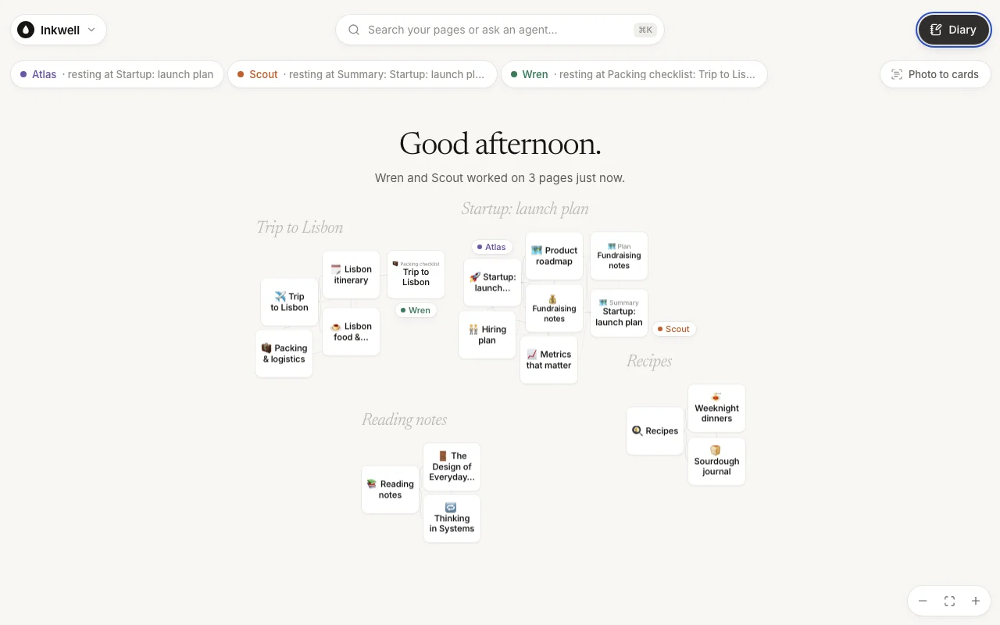
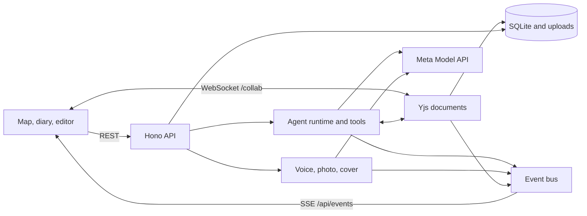

# Inkwell

A notebook that writes back.

You write a request in the diary. The ink sinks into the page, a reply writes itself back in the agent's hand, and the agent goes and does the work across your pages: drafting, editing, linking, filing. While it works, its footprints walk across a map of your notebook, so you can see which page it is reading and which one it is changing. Open that page and the new words arrive in the document you are looking at, in the agent's colour, then dry to ordinary ink.

The two ideas come from Harry Potter, Tom Riddle's diary and the Marauder's Map, but only in what the app does. It looks like a calm, modern notebook. The map keeps a couple of easter eggs for anyone who knows the words.

**[Open Inkwell](https://inkwell.76-13-246-244.sslip.io)** · [Demo script](docs/DEMO.md) · [Submission draft](docs/SUBMISSION.md) · [Design](docs/DESIGN.md)




## What you can do

- **Ask in the diary.** Pick Scout (research), Wren (writing) or Atlas (organising), or leave it on **Any agent** and Inkwell picks one from the request's main verb. Each reply is marked "Written with Muse Spark". A failed reply offers **Try again**, and one that ran out of time or steps offers **Continue**.
- **Watch the map.** Every page is a card in a group. Agents walk between cards as they read, write and think. A greeting at the top says what the agents did since you were last there. New pages arrive with an icon.
- **Edit alongside the agents.** Pages are live Tiptap documents. Agent edits stream in as wet ink with the agent's name on its caret. Agents must pass the version they last read, so a write is refused if you typed since then, and the agent is told to read the page again.
- **Speak.** The microphone records, Muse Voice transcribes, and the text lands in the composer for you to check before sending ("Transcribed by Muse Voice").
- **Photo to cards.** Photograph sticky notes or a whiteboard. Each note becomes a page on the map ("Read by SAM 3.1 + Muse Spark").
- **Make a cover.** Muse Image makes a cover for a page from its title and opening text. It shows on the page and on its map card.
- **Hand off.** An agent can ask another for help. The child run is linked to its parent, draws on the same budget, and its report comes back quoted and signed.
- **Delete with undo.** Deleting a page holds the delete for a few seconds behind an Undo notice.

Each browser gets its own anonymous notebook, seeded with a Lisbon trip, a startup launch plan, reading notes and recipes. There is no sign-in. A notebook is deleted 90 days after its last visit. Don't put anything sensitive in the public demo: text, images and audio go to Meta's API when you use the AI features.

## How Inkwell uses Meta's models

| Model | What it does in Inkwell | Code |
| --- | --- | --- |
| **Muse Spark** (`muse-spark-1.3`) | Runs Scout, Wren and Atlas: streamed replies and tool calls (`list_pages`, `read_page`, `search_pages`, `create_page`, `append_to_page`, `edit_page`, `rewrite_page`, `rename_page`, `move_page`, `delete_page`, `ask_agent`). Reads images attached to a diary request. Reads the text of photographed notes. | [`agents/model.ts`](src/server/agents/model.ts), [`agents/runtime.ts`](src/server/agents/runtime.ts), [`agents/tools.ts`](src/server/agents/tools.ts), [`media/photo.ts`](src/server/media/photo.ts) |
| **Muse Voice Transcribe** (`muse-voice-transcribe-1.0`) | Turns a diary recording into text. The browser records WAV; the server checks the format and calls `/asr/transcribe`. | [`diary/recorder.ts`](src/client/diary/recorder.ts), [`media/transcribe.ts`](src/server/media/transcribe.ts) |
| **SAM 3.1** (`sam-3.1`) | Finds each sticky note or block of handwriting in a photo. Its boxes go to Muse Spark with the image, and also set where the cards land on the map. | [`media/photo.ts`](src/server/media/photo.ts), [`media/boxes.ts`](src/server/media/boxes.ts) |
| **Muse Image** (`muse-image-1.0`) | Makes a page cover from its title and excerpt; stored as an attachment. | [`media/illustrate.ts`](src/server/media/illustrate.ts), [`lib/media.ts`](src/client/lib/media.ts) |

The model IDs and API base URL are set in [`.env.example`](.env.example). The Meta API only accepts `tool_choice: "auto"` and `max_completion_tokens`; the adapter in `model.ts` handles that. The welcome screen's photographs were also made with Muse Image, by [`scripts/paint-objects.mjs`](scripts/paint-objects.mjs).

## Architecture

One TypeScript app in one container. The shared contract is [`src/shared/types.ts`](src/shared/types.ts).

- **Client:** React 19 and Vite. The map ([`src/client/map`](src/client/map)), the diary ([`src/client/diary`](src/client/diary)) and pages with a Tiptap 3 editor ([`src/client/page`](src/client/page)).
- **Server:** Hono on Node 22, SQLite (better-sqlite3), Hocuspocus for live Yjs documents at `/collab`, and server-sent events at `/api/events` for diary ink, page changes and footprints.
- **Agents:** the Vercel AI SDK against the Meta Model API. Agents edit pages on the server through the same Yjs documents the editor is connected to, so their changes stream to anyone with the page open. Writes to one page are serialised with a per-page lock. A run has a step limit, a token allowance and an 8-minute deadline. An agent it hands off to draws on the same tool-call budget and gets a share of its tokens and time; handoffs stop three levels deep. Stopping a run stops its children but doesn't undo finished edits. If the server restarts mid-run, the run is closed as interrupted on the next boot, and the diary says "Inkwell restarted while this was being written." with a Try again button.



## Run it locally

Node 22 or newer.

```sh
npm ci
cp .env.example .env     # set META_API_KEY in .env; never commit it
npm run dev              # client http://localhost:5173, API on :8787
```

Without a key the notebook, editor and map work; the diary keeps your words and says the agents aren't connected yet. To check a key against all four models (five requests): `node --env-file=.env scripts/smoke-meta.mjs`.

Production build: `npm run build && NODE_ENV=production npm start`, then open `http://localhost:8787`.

## Rehearse without a key

```sh
npm run rehearse         # http://localhost:5174
```

This starts a local stand-in for `api.meta.ai` with real tool calls chosen by a keyword planner, a fixed transcript, a drawn cover and fake SAM boxes, so every flow runs in a browser. Nothing it returns comes from a model, and it never reads `.env`. See [`scripts/rehearsal/README.md`](scripts/rehearsal/README.md).

## Test

```sh
npm run typecheck
npm test                                        # 387 tests, models mocked
npx tsx --test scripts/rehearsal/fake-meta.test.mjs
node --test scripts/corpus/fake-server.test.mjs
```

The [agent corpus](scripts/corpus/README.md) sends twelve real requests through the public HTTP API and checks what was saved, not what the agent claimed: `npm run corpus -- --base http://localhost:8787`. It spends model credit and leaves its workspaces in the data directory, so point it at a throwaway `DATA_DIR`.

## Deploy

One Docker container behind nginx, with SQLite and uploads under `/opt/inkwell/data`. `./deploy/deploy.sh hostinger-hermes` ships the committed `HEAD` and waits for the health check. First-time TLS, environment changes and the rules for the neighbouring deployment on the same host are in [`deploy/README.md`](deploy/README.md). There is no automatic data rollback.

## Limits and known issues

- **Not yet tested against the real Meta API.** All tests and rehearsals so far use mocks or the stand-in. Live quality, latency and cost are unmeasured.
- **The cover prompt still asks for a "parchment map vignette"**, which doesn't match the current design ([`illustrate.ts`](src/server/media/illustrate.ts)).
- **Photo to cards always credits SAM.** If SAM fails or finds nothing, Muse Spark finds the notes on its own, but the notice still says "Read by SAM 3.1 + Muse Spark". SAM's boxes are used; its masks aren't.
- **No review step or undo for agent edits.** Version checks stop an agent overwriting what you typed, but a finished edit stays until you change it. Undo covers deleting a page yourself, not an agent's `delete_page` (a soft delete with no restore in the UI).
- **Any agent** routes by keywords in the request, not by a model call. It is fast and predictable, and sometimes picks the wrong agent.
- **Anonymous notebooks only.** No accounts, sharing or multi-device sync; clearing the browser's cookies loses access to the notebook.
- **No local-model mode.** Self-hosting still needs a Meta API key for the AI features.

Built for the Meta Global AI Developer Hackathon, theme "Build for Your World". [`docs/PLAN.md`](docs/PLAN.md) has the build log.
